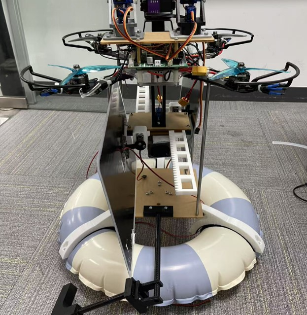

# Solar-Enhanced Biomimetic UAV Research Platform

*A modular quadcopter research platform exploring solar-assisted endurance and multi-terrain perching for outdoor observation.*

<!-- HERO PHOTO: Save the best physical photo of the complete drone as assets/drone-prototype.jpg, then uncomment the next line. -->
<!--  -->

## Overview

This project explores a UAV platform for longer-duration outdoor research and wildlife observation. It combines a deployable solar-tracking system with three ways to transition from flight to a stationary state: suction, gripping, and flotation. The design aims to reduce reliance on fixed charging locations; **infinite endurance is a design objective, not a capability demonstrated by the current prototype**.

<!-- CAD OVERVIEW: Save the overall CAD render as assets/drone-cad-overview.png, then uncomment the next line. -->
<!--  -->

## System overview

- **Quadcopter and flight control:** STM32F407VGT6 flight controller, BMI088 inertial sensor, SPL06 barometric altimeter, AK8975 magnetometer, PID control, and SPI Flash flight-data storage.
- **Auxiliary control:** A separate ESP32-based board controls the attachment modules and auxiliary hardware.
- **Solar system:** Two 10 W photovoltaic panels on a deployable rack-and-pinion mechanism with dual-axis azimuth/elevation adjustment.
- **Wildlife observation:** Two synchronized rear two-axis camera gimbals, designed for video transmission and dedicated recording.
- **Multi-terrain operation:** Interchangeable suction and claw modules, plus an inflatable flotation device.

## 1. Perching and landing mechanisms

The platform uses three static operating modes designed for different environments. Each mode has trade-offs and does not work on every surface.

### Suction module

A dual-suction-cup assembly uses silicone cups, a 13 L/min air pump, and pressure feedback to attach to smooth surfaces such as glass and tile. Sealing and leakage were important design challenges during development.

<!-- PHOTO: Save the physical wall-attachment photo as assets/suction-wall-test.jpg. -->
<!--  -->
<!-- CAD: Save the suction-module render as assets/suction-cad.png. -->
<!--  -->

### Gripper

The claw is inspired by biological gripping structures. A geared linkage synchronizes the gripping elements, and a worm gear helps maintain grip without continuous actuator power.

<!-- PHOTO: Save the physical claw photo as assets/gripper-prototype.jpg. -->
<!--  -->
<!-- CAD: Save the gripper render as assets/gripper-cad.png. -->
<!--  -->

### Flotation module

An inflatable ring provides buoyancy on water and can help cushion landing on uneven terrain when partially inflated. The prototype was also able to propel itself on the water using its pump-based system; stability in rough water remains a limitation.

<!-- PHOTO: Save the physical flotation-device photo as assets/flotation-prototype.jpg. -->
<!--  -->
<!-- CAD: Save the flotation-module render as assets/flotation-cad.png. -->
<!--  -->

## 2. Solar harvesting and tracking

Two 10 W panels deploy using a rack-and-pinion support. A dual-axis mechanism adjusts azimuth and elevation to orient the panels toward the sun. The key optimization problem is balancing solar energy captured against energy spent moving the servos.

The model compares net energy at a candidate maximum tracking threshold, \(\theta_{max}\):

\[
E_{net}(\theta_{max}) = E_{gain}(\theta_{max}) - E_{servo}(\theta_{max})
\]

A solar-position simulation was run for Santa Barbara on March 7, 2025, using a 10-second time step and idealized clear-sky assumptions. The paper reports an optimal threshold of approximately **7.4° under those modeled conditions**. This is a simulation result for a particular day and model—not a universal optimum or proof of extended flight endurance. The full paper contains the detailed method, assumptions, calculations, and discussion.

<!-- CAD: Save the solar-tracking mechanism render as assets/solar-tracking-cad.png. -->
<!--  -->
<!-- FIGURE: Save the annual sun-path illustration as assets/annual-sun-path.png. -->
<!--  -->
<!-- FIGURE: Save the Python simulation graph as assets/solar-threshold-results.png. -->
<!--  -->

## 3. Electronics and control

The flight controller is built around an **STM32F407VGT6** with inertial, altitude, and magnetic sensing, PID-based stabilization, and onboard flight-data storage. A separate **ESP32** board coordinates auxiliary systems such as the suction pump, valves, servos, and module interfaces.

<!-- OPTIONAL PHOTO: Save a photo of the actual flight-controller PCB as assets/flight-controller.jpg. -->
<!--  -->

## 4. Prototype tests

The paper reports these key results from static-module tests:

| Test | Reported result |
|---|---|
| Suction on tile | Initial attachment took 1:12–1:34 across three trials; pressure-controlled holding exceeded 30 minutes. |
| Suction on glass | Initial attachment took 4:43–5:11 across three trials; pressure-controlled holding exceeded 30 minutes. |
| Gripper | All nine reported trials succeeded on 75 mm, 80 mm, and 110 mm PVC pipes. |
| Flotation | The prototype floated and could propel itself using the pump-based system. |
| Solar tracking | A simulation was used to compare candidate thresholds and estimate the threshold that maximized modeled net energy. |

The reported charge-consumption figures were 119 mAh for the suction tests and 52 mAh for the gripper tests. These results describe the reported test conditions; they are not a full demonstration of energy-neutral or indefinitely sustained operation.

## 5. Limitations and future work

Current limitations include the platform's tall form factor, suction reliability on rough or porous surfaces, slow claw actuation, flotation stability in rough water, possible camera obstruction, and the weather dependence of solar charging. The solar model also uses simplifying assumptions and requires further real-world validation.

Next steps include reducing mass and improving balance, weatherproofing, measuring actual net solar gain, refining the tracking mechanism, and developing AI-assisted camera guidance for wildlife observation.

## Full research and project files

This README is a brief project overview. **For the complete methods, design rationale, equations, diagrams, experiments, results, references, and limitations, please refer to the full 40-page research paper.**

- **Full research paper:** [`docs/full-paper.pdf`](docs/full-paper.pdf) — upload the paper at this path, or update the link to match its location.
- **Source code:** [`src/`](src/) — update this link if your code is stored elsewhere.
- **CAD and 3D-print files:** [`cad/`](cad/) — update this link to match your folders.
- **Photos and figures:** [`assets/`](assets/)

---

*This is a prototype research platform. “Infinite endurance” describes the long-term design objective, not a performance claim demonstrated by the current prototype.*
